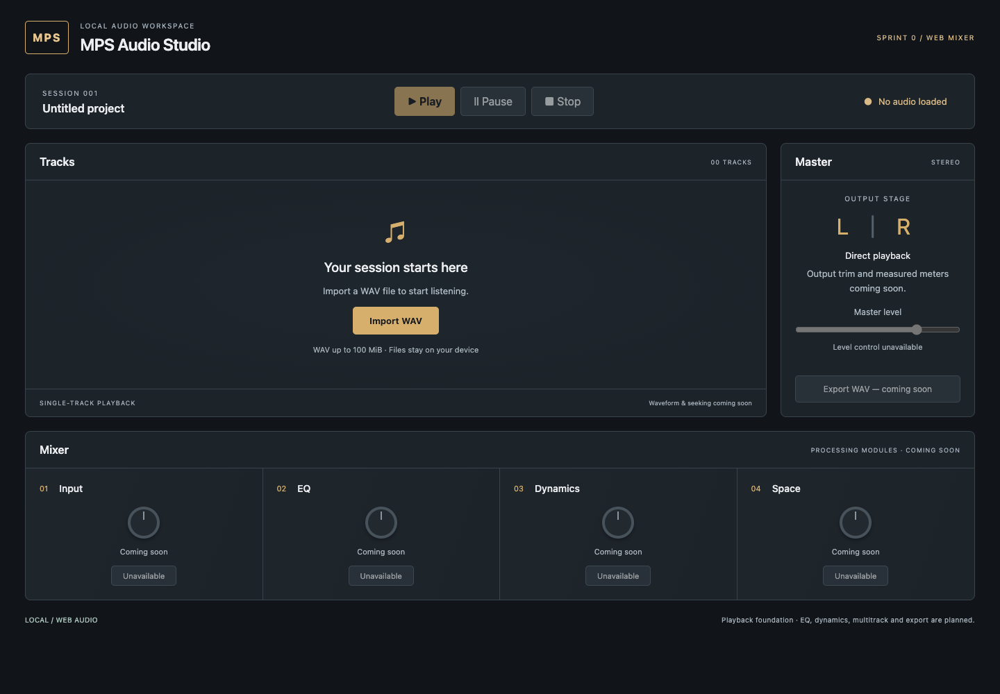
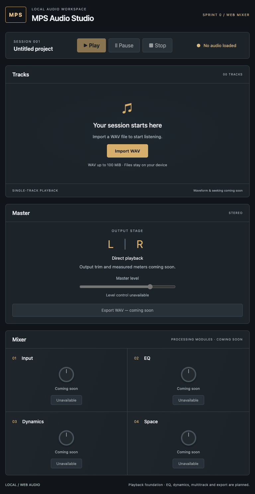

# Sprint 0 — browser mixer and TC-001

Issues: [SCRUM-7](https://genstek69.atlassian.net/browse/SCRUM-7), [SCRUM-10](https://genstek69.atlassian.net/browse/SCRUM-10).

## Baseline and reuse check

Read latest main at `ff64e9f` (SCRUM-6 documentation merge), AGENTS.md, ADR-002, audit, README and the historical PRD/architecture/UX/DSP/QA/implementation docs before editing. Historical files are preserved.

The starting workspace was empty with no remote. Cloned `genstek/MPS-Audio-Studio` into `MPS-Audio-Studio/`. Checked local Git directories under the Mac user account and remote branches. `feat/web-mixer-foundation` was absent; `git ls-remote origin refs/heads/feat/web-mixer-foundation` returned no ref, and fetching abbreviated audit commit `e3f9d1a` failed. The audit describes unpublished Linux work; those objects were unavailable in this Mac session. No working application code was replaced. This PR creates a new small JavaScript implementation from current main; it does not claim to reuse the unavailable branch.

## Manual TC-001 → automated assertions

Precondition: a fresh browser page with no audio loaded. Run the app and open its local URL.

| Step | Expected result / matching assertions in `tests/e2e/mixer.spec.js` |
| --- | --- |
| 1. Open the app | Page title and MPS Audio Studio heading are visible; Untitled project is shown. |
| 2. Inspect Transport | Named region is visible; status is No audio loaded; Play, Pause, Stop are disabled. |
| 3. Inspect Tracks | Named region and empty-session heading are visible; Import WAV input is enabled; format/size/local-file hint is visible. |
| 4. Inspect Mixer | Named region and Input, EQ, Dynamics, Space strips are visible; processing controls are disabled. |
| 5. Inspect Master | Named region is visible; Master level and Export WAV are disabled. |

The test has no fixed sleeps or snapshots. Accessible roles and labels locate elements. The small loop checks the same unavailable-state promise for each processing strip. See README for headed, UI and report commands.

## Executed evidence — 2026-10-19

Environment: Intel Mac, macOS 13.7.8, Node 22.17.0, npm 10.9.2, Google Chrome 155.0.8059.80 through Playwright's Chromium project / Chrome channel.

- `npx playwright install chromium`: **failed**, current managed Chromium unsupported on mac13.
- Initial `npm run check`: lint and Vite build passed; browser test **failed before launch** because managed Chromium was absent. Resolved by configuring the installed Chrome channel.
- Final `npm run check`: **passed**. ESLint passed; Vitest **4/4** passed; Vite production build passed; Playwright **2/2** passed (TC-001 and WAV playback/replacement decode-error recovery).
- TC-001 passed in 5.7 seconds; playback regression passed in 6.9 seconds; browser suite completed in 11.3 seconds.
- `npm run dev -- --port 5174 --strictPort`: **started**, served app at `http://127.0.0.1:5174/`.
- Browser inspection at 1440×1000 and 768×1024: no page or console errors, no horizontal document overflow. Screenshots captured and visually reviewed below.

## Limits and next work

This is a single-track playback foundation and mixer UI shell. No measured DSP, mastering, audio-fidelity or hardware-listening claims. Tests cover one synthetic mono PCM16 WAV, transport state, mocked source cleanup and replacement decode failure. Other browsers, WAV variants, long/large files, memory responsiveness, hardware output and full accessibility audit remain unverified. The 100 MiB cap is an initial guard, not a proven performance guarantee. Import is via the file picker; drag/drop is not implemented.

Follow-on for SCRUM-10: add explicit TC-002 valid import and TC-003 unsupported/header-invalid input cases, then propose GitHub Actions using managed Chromium on a supported Linux runner once this local setup is reviewed. No remote CI is configured or claimed by this PR. Keep both Jira tasks open for review and their remaining scope. Do not merge until reviewed.
