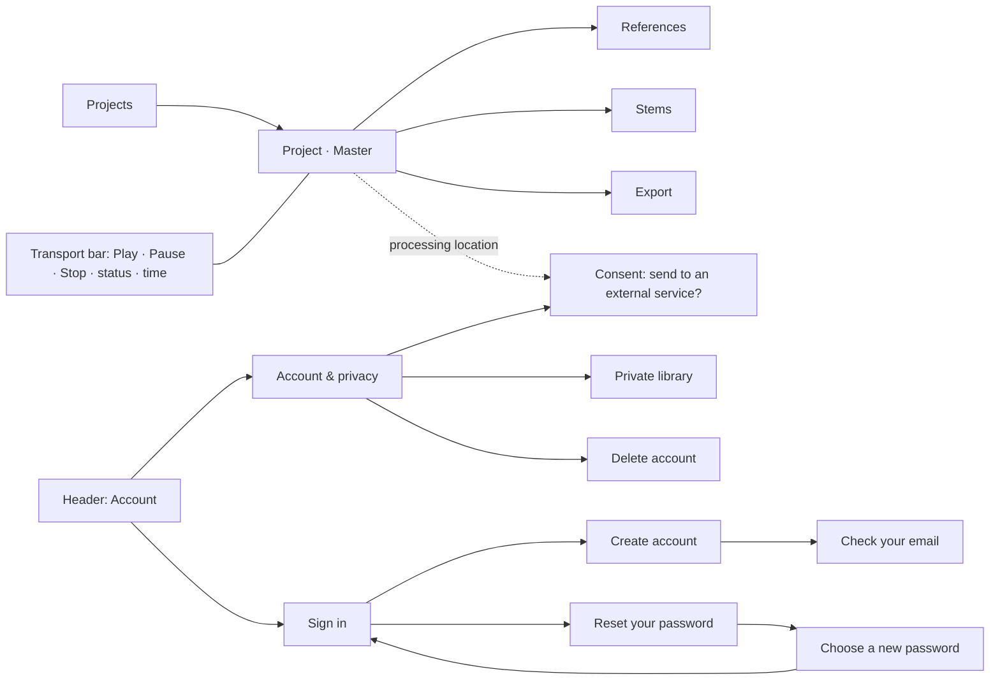

# LAS-43 — Studio navigation and interactive wireframes

Jira: [LAS-43](https://genstek69.atlassian.net/browse/LAS-43) · Work order: `docs/claude-code/2026-10-29/tasks/LAS-43.md` · Mode: DESIGN_REVIEW_REQUIRED · Prerequisites LAS-42 (direction pending), LAS-19, LAS-20

Branch `design/LAS-43-wireframes` · artifact `docs/design/LAS-43/wireframes.html` (open directly in a browser; no server)

Developer status: **BLOCKED** on Gennady's walkthrough — the clickable prototype is prepared; **no feedback is recorded and the design is not accepted** · Gennady's walkthrough: **PENDING** · Jira sync: **SYNC_PENDING**

## What it is
A single-file, **greyscale, structure-only** clickable prototype: boxes, labels and states, no colours, theme or branding (the LAS-42 visual direction is still Pending). It follows the account and privacy rules of ADR-003 (LAS-19) and the privacy policy (LAS-20).

## Information architecture

## Coverage
| Need (acceptance) | Where in the prototype |
| --- | --- |
| Navigation between projects, mixer/mastering, references, stems, account settings (AC-01) | left navigation + header Account button; 12 screens |
| States: empty, loading, ready, playing, paused, error, unsaved change (AC-02) | Master screen "State to preview" switcher drives file line, waveform text, status, Play/Pause/Stop enabled state, error line and header save state |
| Export states (AC-02) | Export screen: Idle → Rendering (cancel) → Done (file, LUFS, true peak, checksum) / Failed (reason, try again) |
| Registration, login, recovery without technical detail (AC-03) | Sign in, Create account, Check your email, Reset your password, Choose a new password — messages match the implemented server answers (LAS-21/22) |
| Local vs external processing consent (AC-03) | "Processing location: this computer ▾" opens the consent screen; Account & privacy lists allowed services |
| Clickable walkthrough by Gennady with recorded feedback (AC-04) | prepared; **Pending** |

Behaviour notes are written into the screens (grey "Note —" boxes): no pretend controls, measured values only, preview/export parity, presets as starting points, reference rights and checksums, original files never overwritten.

## Verification (developer)
`evidence/check-wireframes.mjs.txt` opened every screen and state in Chromium 141: 12 screens shown, 13 internal links all resolve, 7 states set the expected controls, no console or page errors (`evidence/wireframe-check.json`); screenshots in `evidence/screens/` including a 390×844 phone width.

## Decision record
| Date | Feedback / decision | By |
| --- | --- | --- |
| — | Pending: walkthrough of import → play → analysis → reference → export and account recovery | Gennady |

Until the walkthrough: LAS-44 (high-fidelity design system) does not start; implemented screens keep their current structure.
